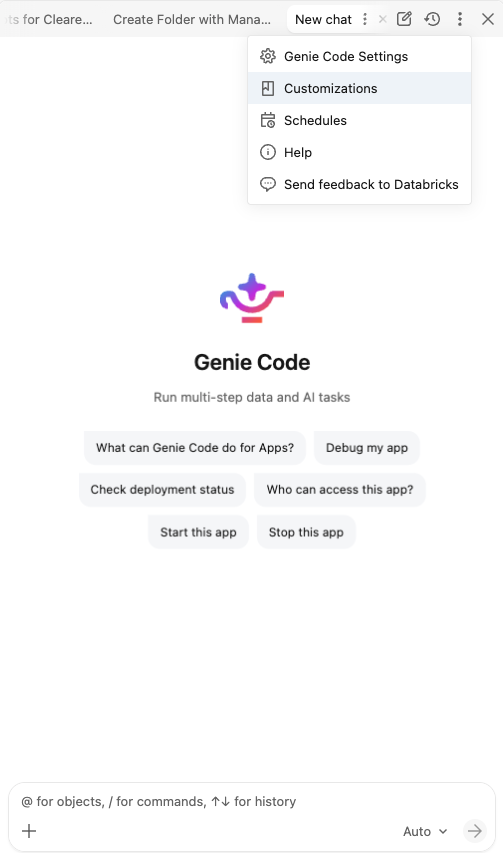
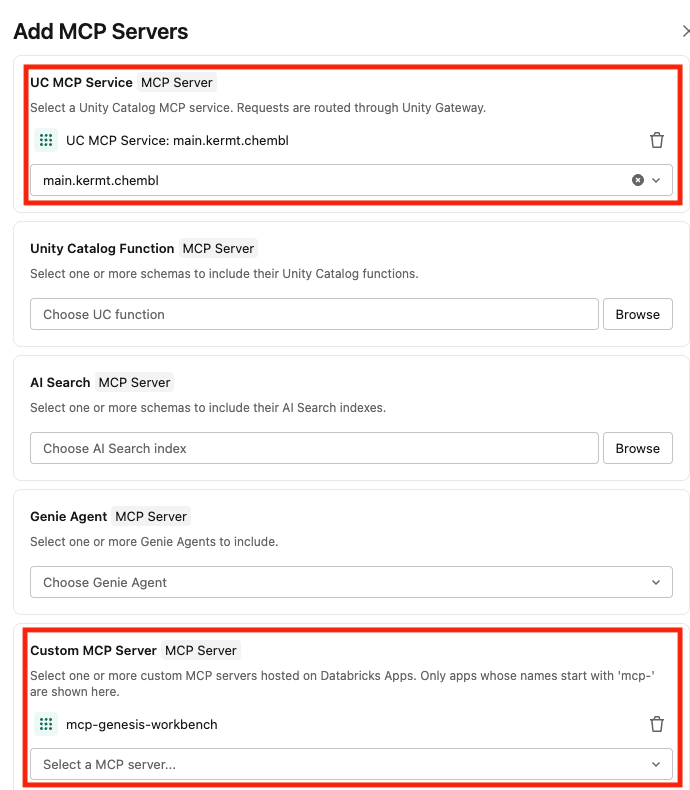
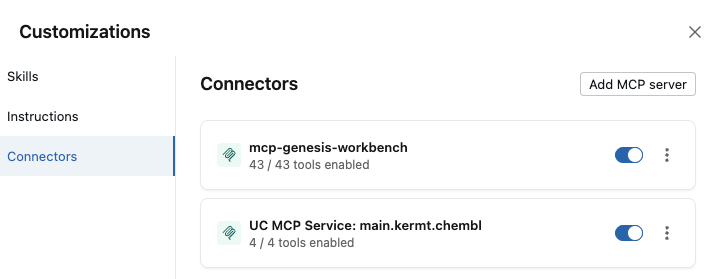
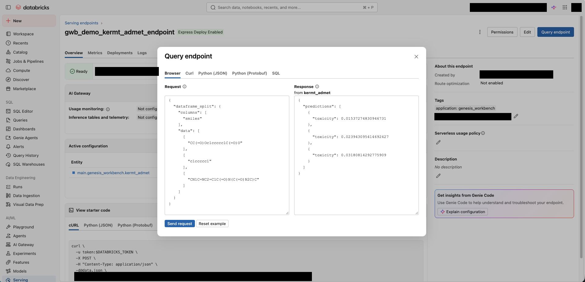
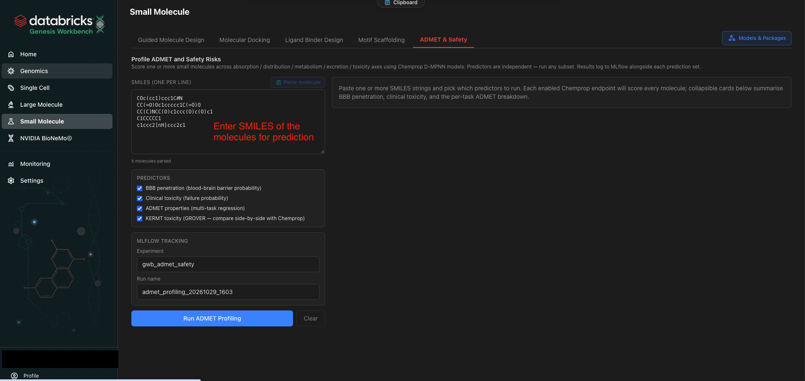
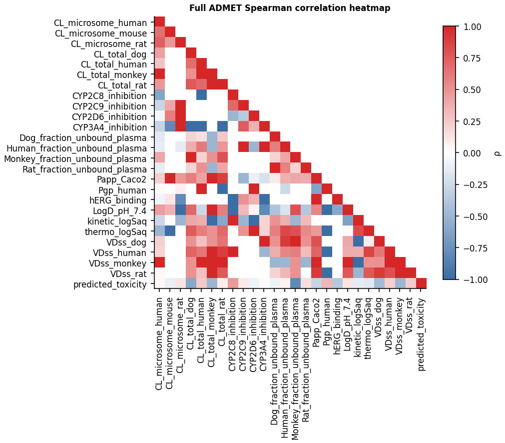
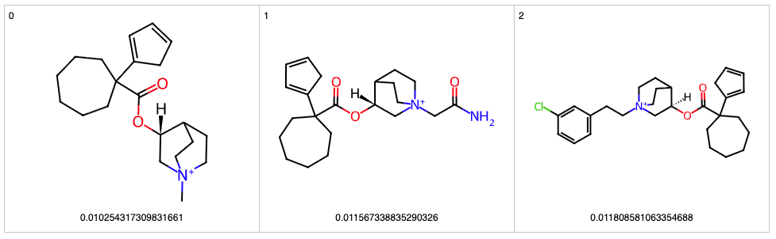
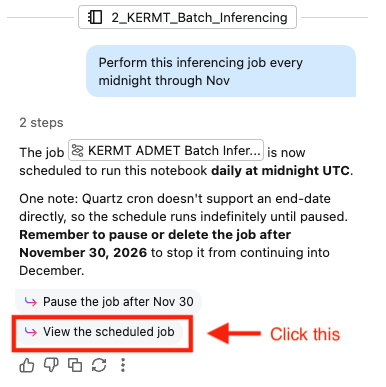
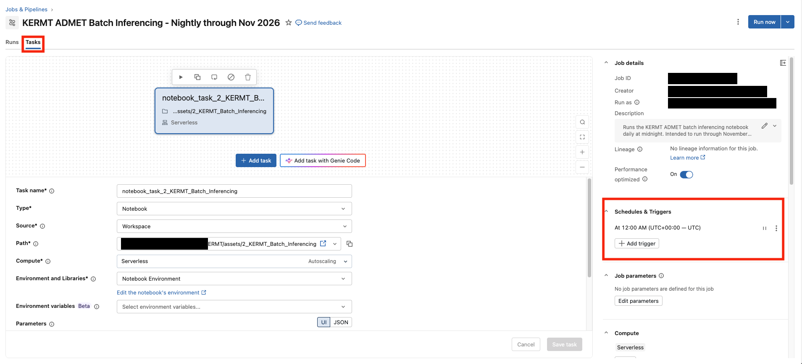

# Virtual screening with KERMT
---
**Estimated time:** 30 mins

**Level:** Easy

## Objective
Often in the hit-to-lead stage, ADMET virtual screening is performed to weed out candidates with undesirable pharmacokinetics and toxicity. At this stage, both the molecules and ADMET assays are virtual. Thus, chemical foundation models like [KERMT](https://arxiv.org/pdf/2510.12719)(Kinetic GROVER Multi-Task) are critical for ADMET screening of large chemical datasets. The following workflow shows how you can use KERMT for such ADMET prediction.

## What this workflow covers
1. Single inferencing of a single molecule with MCP
2. Batch inferencing (i.e. virtual screening) of a chemical dataset
3. Analyze associations between your predictions and laboratory ADMET values
4. Schedule batch inferencing (from task 2) as a daily job

#### About KERMT
KERMT(2.0) is a graph transformer model from NVIDIA pretrained to learn molecular representations of over 11M molecules with a multi-task head for ADMET prediction. The version deployed here on Genesis Workbench has been finetuned on [ClinTox](https://tdcommons.ai/single_pred_tasks/tox/#clintox) binary labels to predict the probability of a drug failing clinical trials due to toxicity.

The base model expects chemical SMILES input and outputs 800-dim molecular embeddings. With the ADMET head, it outputs a ADMET continuous score.

---
## Task 1: Single inferencing
1. Open Genie Code, connect to the ChEMBL and Genesis Workbench MCP.   
Right click on the ellipses and select Customizations. Then add connector MCP servers.

> **Genesis Workbench includes a MCP server** with over 40 tools. It is a [Custom MCP](https://docs.databricks.com/aws/en/agents/mcp-tools/custom-mcp) hosted on Databricks Apps (the `mcp-genesis-workbench` app in your workspace's Apps list).

> **ChEMBL MCP** (available from [Marketplace](https://marketplace.databricks.com/) as `main.kermt.chembl`) allows you to look up SMILES representations of molecules. The KERMT model expects SMILES as input

If the MCPs are correctly added, you should see this:

2. Prompt to get ADMET predictions for a single compound using the KERMT model (e.g. orforglipron)

### Bonus
3. You can also try this on Genie One.

#### Expected Results 
Predicted toxicity for orforglipron is 0.245. 
This should take a min

> **Note** that there may be slight variation due to variations in SMILES

#### Explanation
The KERMT model is already served on Databricks Model Serving. So to do inferencing, you can request it via an MCP tool like we did above or query it over the UI (**Serving** > `gwb_demo_kermt_admet_endpoint`), `curl` or the `requests` library

---
## Task 2: Batch inferencing
1. Open Genie Code, prompt:

> Generate a NB to do batch inferencing on the table main.kermt.data_public_test. Save to a table on my schema, e.g. dbacademy.labuser123

This table stems from the [public data](https://figshare.com/articles/dataset/Datasets_for_Multitask_finetuning_and_acceleration_of_chemical_pretrained_models_for_small_molecule_drug_property_prediction_/30350548) (test split only) in the [KERMT paper](https://arxiv.org/pdf/2510.12719). It was ingested using this [ingestion NB]($./assets/1_Ingest_data) previously generated by Genie Code.

### Bonus
You can also do batch inferencing with the Genesis Workbench app (**Compute** > **Apps** > `genesis-workbench`, then **Small Molecule**) 

#### Expected results
Genie Code should open a new NB and use [`ai_query`](https://docs.databricks.com/aws/en/sql/language-manual/functions/ai_query) to do batch inferencing in parallel.

#### Answer key
- Expected [Batch Inferencing NB]($./assets/KERMT_ADMET_Batch_Predictions)

---
## Task 3: Compare predictions with ground truth
Given the predictions from Task 2 saved in a scored table, tell Genie Code to compare predictions with laboratory ADMET endpoints like CYP2C8_inhibition already in the scored table.

Example prompt:
> Predicted_toxicity is the predicted probability that the drug failed clinical trials for toxicity reasons. Show how it is related to the other ADMET endpoints in my scored table, e.g. dbacademy.labuser123.data_public_test_scored

#### Expected results
Genie Code should generate additional cells in the NB from Task 2 to do a correlation matrix between predicted_toxicity and all the ADMET endpoints

#### Answer key
- Expected [analysis NB]($./assets/KERMT_ADMET_Batch_Predictions)

---
### Task 4: Render some molecules
Prompt Genie Code:
> Take the molecules with the 3 lowest predicted_toxicity, render their structures with mols2grid

#### Answer key

- Expected [analysis NB]($./assets/KERMT_ADMET_Batch_Predictions)

---
## Task 5: Scheduling a job from NB(s)
Prompt Genie Code to turn the NB into a Lakeflow job and schedule it for run every midnight

#### Answer key

- Expected job: see the screenshot below

## Key lessons
- You can host any MCP servers on Databricks. You can easily connect MCP servers in Genie Code, Genie One, Playground and in custom code like Langgraph.
- You can easily serve models like KERMT on Model Serving that can autoscale to zero. It has a REST API for real-time inferencing and `ai_query` for large scale inferencing in parallel.
- You can schedule jobs with full monitoring capabilities
