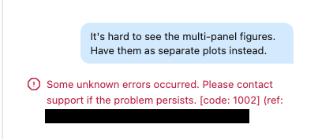

# Databricks-Nvidia Biopharma R&D AI coding [workshop](https://events.databricks.com/FY27Q4-SD-NVIDIA-Reimagining-RDWorkflows-Biopharma/registration)

This repo contains several exercises including prompts and expected answers so you can try this in your own Databricks workspace

## Prerequisites
Some exercises require models deployed within Genesis Workbench
Vital Skills

## Setup
First [setup]($./SETUP.md) your course workspace (10 mins)

## Exercises
Then select an exercise (30-45 mins) and join the working group with a TA to work on it
1. [ADMET Virtual Screening]($./KERMT_ADMET_virtual_screening/KERMT.md) of small molecules with KERMT (Easy)
2. [Antibody design]($./Antibody_Design_RFD4/Antibody_Design_RFD4.md) with RFD4 (Intermediate)
3. [Transcriptomics vector search]($./deploy_scrna_model_and_vector_search/README.md) with TEDDY (Intermediate)
4. [Single-cell RNA ingestion and exploration]($./scRNA_ingestion/scRNA_ingestion.md) (Easy)
5. [Single-cell RNA analysis]($./scRNA_analysis/scRNA_analysis.md) (Intermediate)
6. [Variant calling]($./Variant_Calling_Parabricks/Variant_Calling_Parabricks.md) with Parabricks (Intermediate)

**Bonus** 
7. [Protein embedding and search]($./protein_vector_search/protein_vector_search.md) with ESMC (Easy)  
8. [Protein binder design and optimization]($./De_Novo_Protein_Binder/De_Novo_Protein_Binder.md) with Proteina Complexa (Intermediate)  

## Troubleshooting
1. If Genie Code stop responding, start a new chat.

2. If you run into permissions issues, tell your TA

2. Occasional errors especially in long running conversations. Just start a new chat
