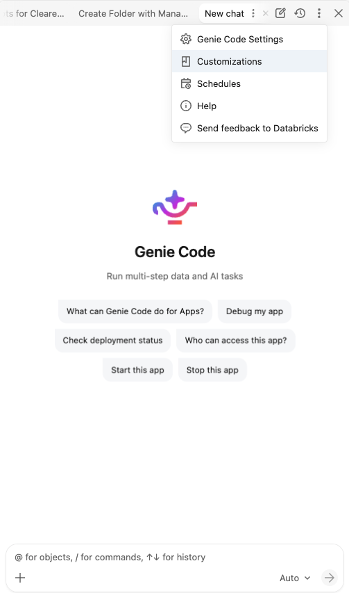
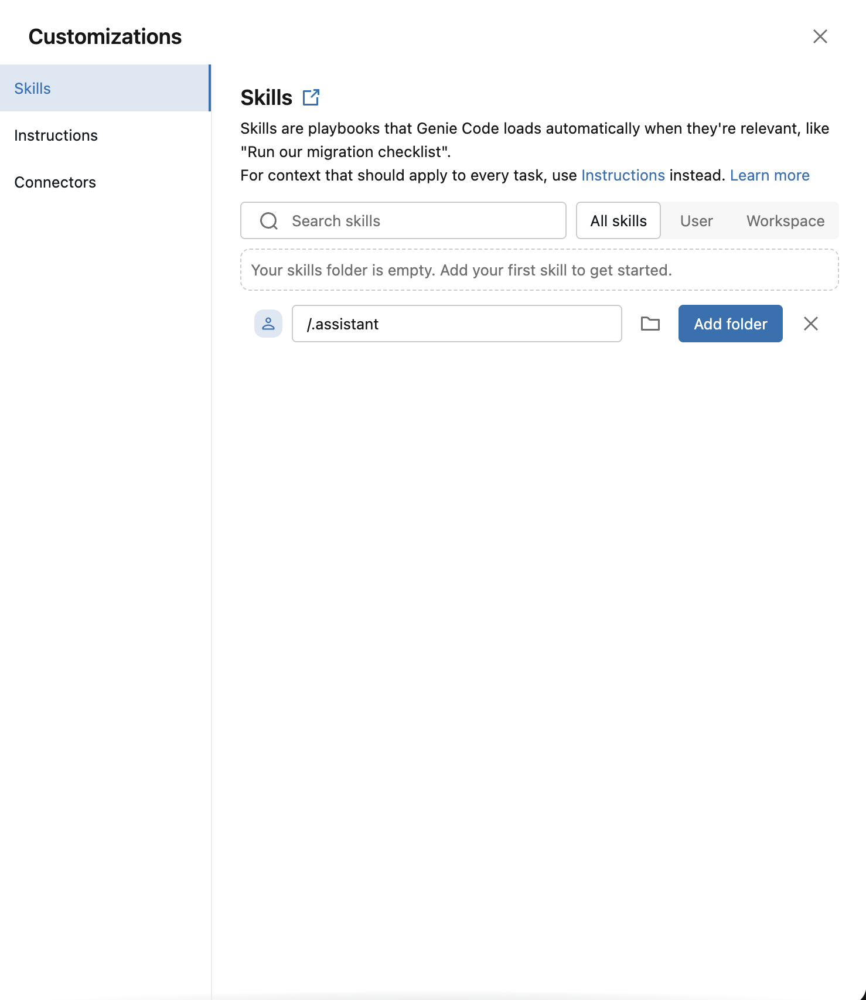
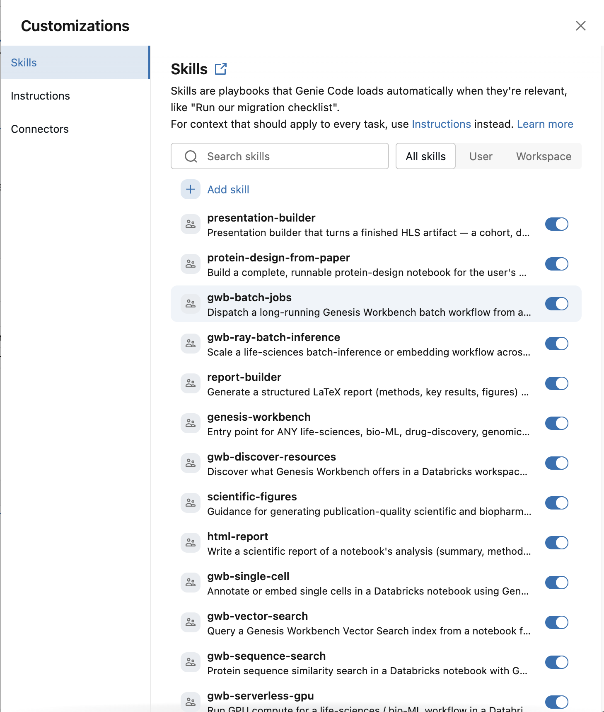
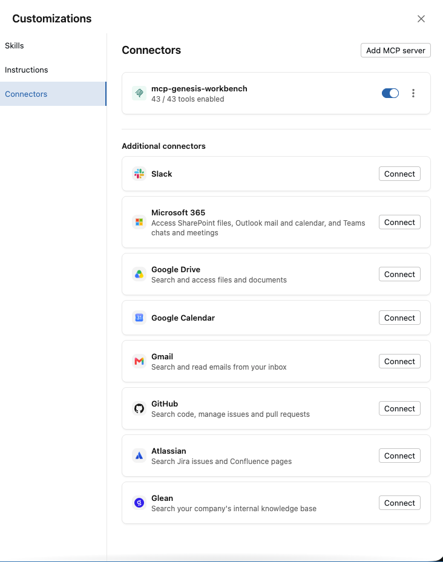
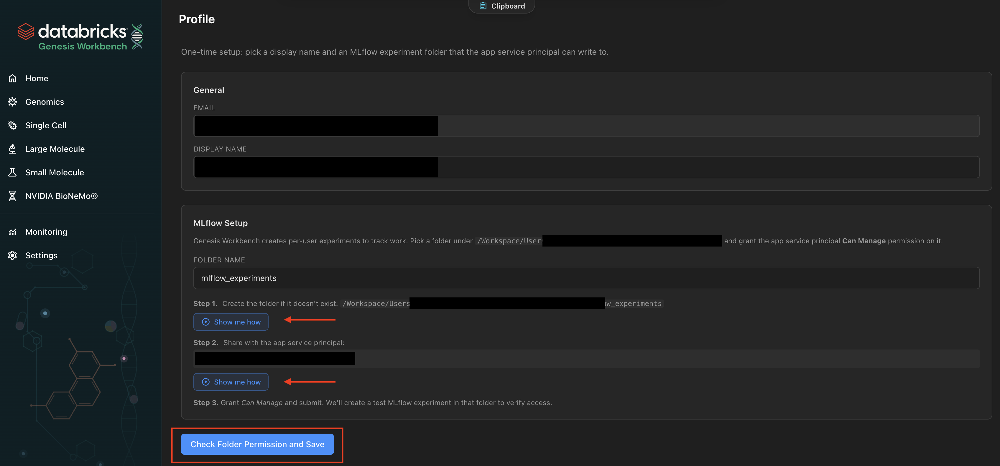
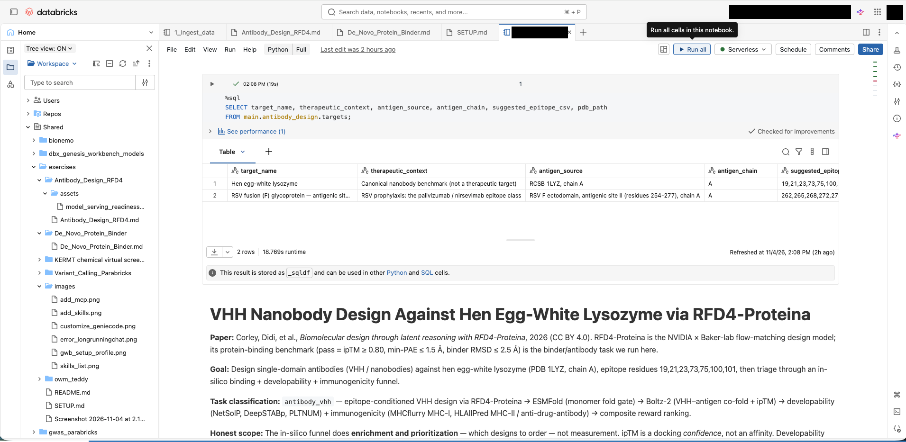

# Setup
**Estimated time:** 10 mins

Before you begin, you'll need to setup:
1. Genie Code to run in Auto mode
1. Add skills 
2. [Optional] Add MCP connections
3. MLFlow logging in your Genesis Workbench profile

## 1. Customize Genie Code
We recommend that you run Genie Code in Auto Mode

## 2. Add Skills (See also [doc](https://docs.databricks.com/aws/en/genie-code/skills#add-skills-from-another-folder))
Go to Genie Code > Ellipsis > Customizations

Add folder, e.g. `/Workspace/.assistant`

We have already cloned [Vital Skills](https://databricks-industry-solutions.github.io/vital-skills/) onto `/Workspace/.assistant`

If added successfully, you should see the following ~20 skills

## 3. Add MCP [OPTIONAL]
You can also customize Genie Code with MCP servers like this

## 4. Set up MLflow logging for your Genesis Workbench profile
Open the Genesis Workbench app (**Compute** > **Apps** > `genesis-workbench`)  → **Profile** and set **MLflow experiment folder** to e.g. `mlflow_experiments`, then save.

Click on the "Show me how" buttons on the Genesis Workbench app and follow the steps to set up the Experiments folder and permissions for the App Service Principal to write to the Experiments folder

On the Genesis Workbench App, click on the "Folder Permission and Save" button to check that this is properly set up. It should take a minute.

## 5. Select and start an exercise
Select a subfolder in `exercises`. Open it and follow the instructions in *.md. Open Genie Code and start prompting. 

To run a Genie-Code generated NB, click Run All or you can also run one cell at a time as in any Jupyter notebook. Run on Serverless where possible.

