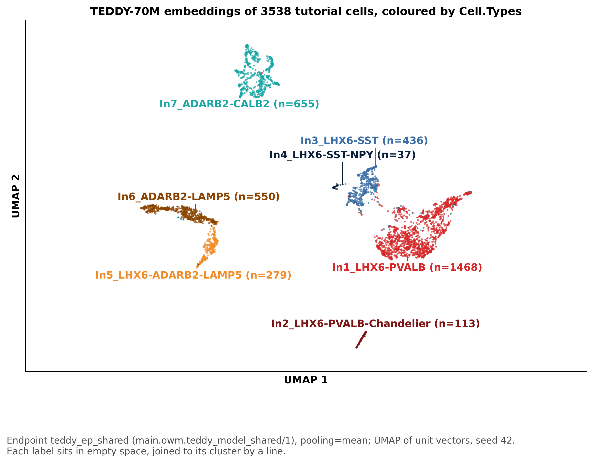
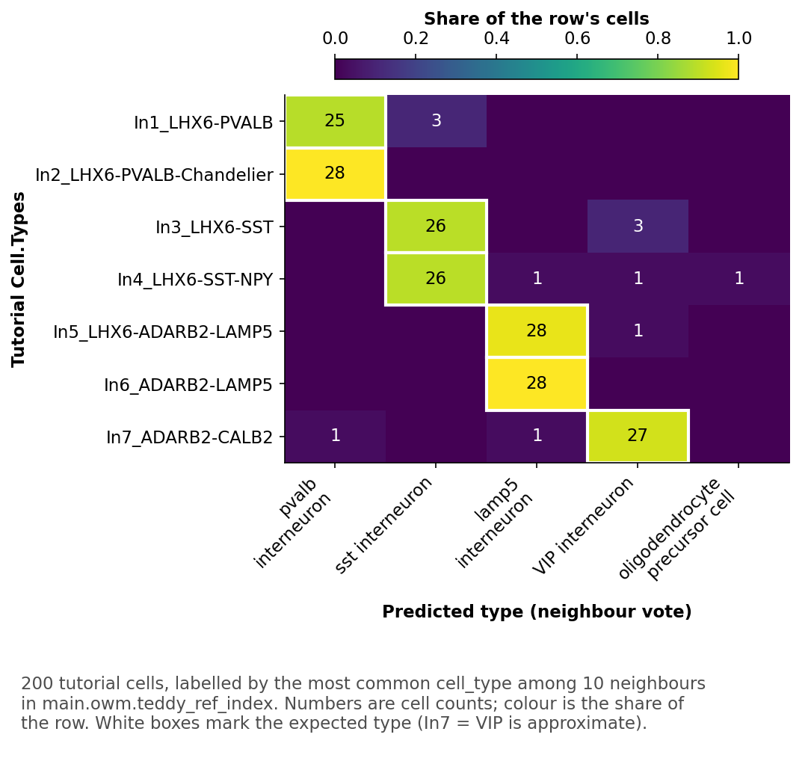

# Hands-on: Label TEDDY's tutorial cells with a Census index
---
**Estimated time:** 30 mins

**Level:** Intermediate

**In plain English:** You use a shared, already-running model endpoint to fingerprint 3,538 tutorial cells, then label 200 of them by finding each one's 10 nearest known cells in a shared AI Search (formerly Vector Search) index. You deploy nothing — you just call what's already there. No GPU needed.

| Step | What you do | You get | About |
| --- | --- | --- | --- |
| H1. Embed | Send TEDDY's 3,538 tutorial cells through the shared endpoint | your table, a UMAP | 10-15 min |
| H2. Look up | Label 200 cells by their 10 nearest Census cells in the shared index | a count table, a confusion matrix, % matching | 10 min |
| Optional: Report | An HTML report of your run | `handson_report.html` | a few min |

Paste H1, then H2, into one **new** Genie Code chat (**Agent** mode, Effort **Auto**).  This prompt file has one example run notebook, [`runs/teddy_handson`]($./runs/teddy_handson) next to it. 

- H1 creates your own notebook in your home folder (`/Users/<your user name>/teddy_handson/`),
- H2 and the optional report add to it. 

This example shows what Genie Code generates: the skills keep runs
consistent, but yours may differ slightly. 

You deploy nothing and need no GPU in this exercise. You **read** the shared endpoint, index and files in `main.owm` and **write** only to your own
schema `dbacademy.<me>`, which the lab created for you (only you can write there), and to your own home folder for notebooks (never to `/Shared`). 

Read grants are already set — if something fails on permissions, ask your instructor.

> **Note:** For another workspace, change only the Values line in H1: the shared read location (catalog, schema,
volume; `account users` needs the read grants in `setup_and_demo/Attendee Access Grants and Checks`) and the write
location (any schema you own); every other name is relative to them.

---    

## H1: embed the tutorial cells (15 mins)

```text
Using the open-weight-models skill (follow the "Short runs" list in its teddy.md), create a NEW
notebook `teddy_handson_<me>` (don't reuse or edit an existing one; if the name already exists, add
a short suffix, e.g. `teddy_handson_<me>_2`) in my home folder at
`/Users/<my full user name>/teddy_handson/` (create the folder if it doesn't exist; never create
or edit notebooks under `/Shared`; check the real path after creating it) on serverless compute (no GPU: if the notebook is attached to GPU
compute, switch it to CPU serverless before running); read the user at run time. Make the first
cell a markdown title cell (a heading and 1-2 sentences on what H1 and H2 do), with the code below it.
Values: `me` = my user name before the @, dots and dashes as underscores. Shared (read only, never
write): catalog `main`, schema `owm`, volume `teddy_files` (index `teddy_ref_index` is in this schema;
shared files in the volume's `shared/` folder); shared endpoint `teddy_ep_shared`. Mine (write here
only): schema `dbacademy.<me>` (it already exists and I own it; don't create it); my table
`dbacademy.<me>.teddy_tutorial_cells`; my volume `dbacademy.<me>.teddy_handson` (create it if
missing); my folder = the root of my volume. First check that Spark's current user and the SDK's
current user are the same (stop if not), that `dbacademy.<me>` exists, and that the shared files,
endpoint and index exist. Then show the endpoint's model version and Setup's
`tutorial_validation.json` (or "not run"). Embed every cell in
`shared/teddy_70m/data/sample_data.h5ad` (use `.raw.X` counts) through the endpoint and write my table (cell_id,
embedding, cell_type, donor_id, model_version). Figure: UMAP coloured by `Cell.Types`, each cluster
labelled on the plot with its full type name (more types than the colour rule allows); save it to my
folder. Rules: don't create or change endpoints or indexes; never write to `main.owm` or the shared
volume; stop and ask if my table exists or my folder already has files; stop after 3 failed
attempts at the same error. Use only this prompt and the skills as sources: don't use other
notebooks, queries or past chats.
```

#### Answer key
- Expected [NB]($./runs/teddy_handson)
- Expected UMAP


---
## H2: look them up in the Census index

```text
For 200 tutorial cells, about the same number from each `Cell.Types` (seeded), query index
`teddy_ref_index` (10 neighbours) and label each by the most common neighbour type. Expected types: In1 and In2 = pvalb, In3
and In4 = sst, In5 and In6 = lamp5, In7 = VIP (approximate) GABAergic cortical interneuron. Show a
count table (tutorial type x predicted type) and the same as a confusion-matrix figure (a count in
each box, the expected type marked; save it to my folder), the % matching the expected type overall and per type,
and 2-3 plain sentences on what this shows and what it can't.
```

#### Answer key
- Expected [NB]($./runs/teddy_handson)
- ~95% of the cells match the expected type


---
## Optional: report

```text
Using the html-report skill, write a short report of this run (the endpoint and model version, the
tutorial data, the tutorial check, the UMAP, the lookup table, the confusion matrix and % matching, caveats including which
expected types are approximate (In7 = VIP)), using only
numbers from this notebook. Save it to my folder (my volume in `dbacademy.<me>`) as `handson_report.html`, show its path as a link with a
preview below, and tell me how to save it as a PDF.
```
