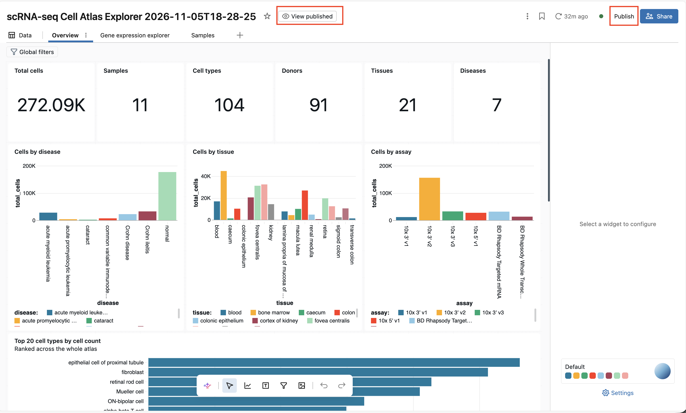

# Single Cell RNA Ingestion and Exploration
---
**Estimated time**: 30 mins

**Level**: Easy

**Objective:** Demonstrate single-cell RNA processing workflows using Databricks Genie Code to: 
1. ingest raw h5ad data into Delta tables, 
2. explore cell metadata, and
3. generate interactive dashboards

**Core Concepts:** This exercise will use the **`sc-rnaseq`** [skill](https://databricks-industry-solutions.github.io/vital-skills/) to do data ingestion to Delta, h5ad parsing, metadata exploration, interactive dashboard generation, and Lakehouse RT vs. DBSQL performance comparison

The generated code should show best practices for rapid processing of large-scale scRNA data using [**`cspray`**](https://www.biorxiv.org/content/10.64898/2026.02.06.704110v1.full) and [**Lakehouse RT (Realtime**)](https://www.databricks.com/blog/introducing-lakehousert-real-time-performance-unified-lakehouse)

---
## Step-by-Step Guide

### 1. Data Ingestion & Delta Table Conversion
* Genie Code prompt:
  > Create a new NB and read all the h5ad files at dbacademy.scrna.raw_h5ad into delta tables on my schema (e.g. dbacademy.labuser123), and prepare them for dashboards. 

#### Answer key
Expected [ingestion NB]($./assets/scrna_ingestion)

### 2. Metadata Exploration & Dashboard Ideation
* Genie Code prompt:
  > Ok now we have the tables - can you add a cell to the end to report on the metadata available on obs and sample - with a view to dashboard creation and ideation

#### Answer key
Expected [ingestion NB]($./assets/scrna_ingestion)

---
### 3. Dashboard Generation (>20 mins)
* Genie Code prompt:
  > Can you make a dashboard for me?

* Review the generated dashboard and iterate as needed with Genie Code (e.g. adding charts, queries, moving widgets, changing axes).
* When satisfied with your dashboard, click Publish to make it viewable by intended users. 
* Click on "View published" to see what your viewers would experience

#### Answer key
Expected dashboard: as in the screenshot above (`assets/dashboard.png`).

> **Note:** Instead of DBSQL, you can also use [**Lakehouse RT engine**](https://www.databricks.com/blog/introducing-lakehousert-real-time-performance-unified-lakehouse) which can run large queries 5 times faster

### 4. Genie One for Data Discovery
* In the published dashboard, ask in the Genie bar at the bottom
  > How many Crohn's samples do we have and how many goblet cells are in these samples?

  > How many donors are there across these samples and how many cells per donor?

#### Expected Results
- Crohn disease: 22,370 total cells, 18 donors, 8 - 7189 cells per donor, 230 goblet cell
- Crohn ileitis: 32,458 total cells, 11 donors, 831 - 4975 cells per donor, 1 goblet cell

 